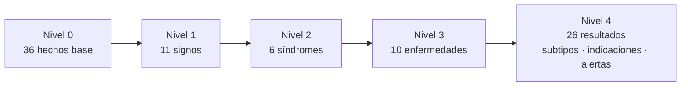
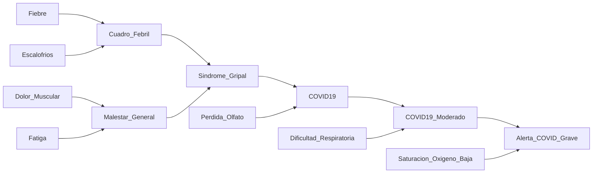

# Proyecto Aplicativo 2 · Motor de inferencia simbólica

**Introducción a la Inteligencia Artificial · Pontificia Universidad Javeriana**

> Un sistema experto de diagnóstico que razona con lógica proposicional. Dado un conjunto de síntomas y una hipótesis médica, decide si la hipótesis se deduce de una base de 65 reglas y explica paso a paso cómo llegó a esa conclusión.

---

## 1. Resumen

Este proyecto implementa un **motor de inferencia de propósito general** con los dos algoritmos clásicos de la IA simbólica: encadenamiento hacia adelante (*forward chaining*) y encadenamiento hacia atrás (*backward chaining*). El conocimiento no está escrito en el código: vive en un archivo JSON externo con reglas de Horn, de modo que el mismo motor sirve para cualquier dominio. Como dominio de prueba se modeló el diagnóstico diferencial de infecciones respiratorias y síndromes febriles tropicales, donde muchas enfermedades comparten los mismos síntomas iniciales y se separan por un único dato distintivo.

| Dato | Valor |
|---|---|
| Reglas de Horn en la KB | 65 |
| Hechos de entrada (síntomas, antecedentes y criterios de gravedad) | 36 |
| Enfermedades modeladas | 10 |
| Resultados de nivel 4 (subtipos, indicaciones y alertas) | 26 |
| Profundidad de inferencia de los resultados finales | entre 4 y 5 niveles |
| Reglas de alerta (diagnóstico inferido + síntoma crítico) | 15 |
| Casos clínicos probados | 4 (5 ejecuciones con ambos motores) |
| Comparaciones entre motores en las pruebas automáticas | 53.000 |

## 2. El problema lógico

El sistema resuelve el problema de la **consecuencia lógica** `KB ⊨ α`: ¿se deriva el objetivo α de los hechos Δ aplicando las reglas de la KB?

| Elemento | Qué es en este proyecto | Ejemplo |
|---|---|---|
| **KB** | Reglas de la forma `P1 ∧ P2 ∧ … ∧ Pn → Q`, guardadas en `base_conocimiento.json` | `Sindrome_Gripal ∧ Inicio_Brusco → Gripe` |
| **Δ** | Síntomas y antecedentes observados en el paciente | `Fiebre, Escalofrios, Dolor_Muscular, Fatiga, Inicio_Brusco` |
| **α** | Diagnóstico, subtipo, indicación o alerta que se quiere verificar | `Gripe` |

Las reglas son **cláusulas de Horn definidas**: varios antecedentes unidos por AND y un único consecuente positivo, sin negación. Esa restricción tiene una consecuencia importante: tanto el encadenamiento hacia adelante como el hacia atrás son *correctos y completos*, es decir, responden verdadero exactamente cuando α está en la clausura deductiva de Δ. Por eso los dos motores deben coincidir siempre, y esa coincidencia se usa como prueba de que están bien implementados (sección 8).

La lógica es **monótona**: un hecho deducido nunca se retira. Lo que no se pueda decir como afirmación positiva (por ejemplo «sin fiebre») debe modelarse como un hecho propio.

## 3. Arquitectura del proyecto

```
.
├── proyecto_inferencia_final.py   # motores hacia adelante y hacia atrás + casos clínicos
├── base_conocimiento.json         # KB externa con 65 reglas
├── validar_kb.py                  # auditoría automática de la KB
├── pruebas_equivalencia.py        # pruebas de ambos motores
├── Informe_Tecnico_Proyecto2.pdf  # informe técnico
└── README.md
```

El flujo es simple: `MotorInferencia` carga el JSON, recibe Δ y α, razona con el algoritmo elegido y deja la explicación en `traza_explicacion`.

La KB se organiza en cuatro niveles, de lo general a lo particular. Cada nivel acumula categorías en la memoria de trabajo antes de que el siguiente pueda dispararse, así que el motor nunca salta de un síntoma a un diagnóstico en un solo paso.



## 4. La base de conocimiento

### 4.1 Formato de una regla

Cada regla del JSON trae `id`, `antecedentes` (unidos por AND) y `consecuente` (uno solo). Los campos `nivel` y `descripcion` los ignora el motor y sirven para documentar y auditar.

```json
{
  "id": "R21",
  "nivel": 3,
  "antecedentes": [
    "Sindrome_Gripal",
    "Perdida_Olfato"
  ],
  "consecuente": "COVID19",
  "descripcion": "Síndrome gripal con pérdida del olfato: COVID-19."
}
```

### 4.2 Los cuatro niveles

| Nivel | Transformación | Reglas | Hechos nuevos | Ejemplo |
|---|---|---|---|---|
| 1 | Hechos (síntomas) → signos | 11 | 11 | `Fiebre ∧ Escalofrios → Cuadro_Febril` |
| 2 | Signos → síndromes | 8 | 6 | `Cuadro_Febril ∧ Malestar_General → Sindrome_Gripal` |
| 3 | Síndromes + hecho diferenciador → enfermedades | 11 | 10 | `Sindrome_Gripal ∧ Perdida_Olfato → COVID19` |
| 4 | Enfermedad → subtipo, indicación o alerta | 35 | 26 | `COVID19_Moderado ∧ Saturacion_Oxigeno_Baja → Alerta_COVID_Grave` |

Las reglas del nivel 4 también se encadenan entre sí: un subtipo ya inferido (por ejemplo `COVID19_Moderado`) puede combinarse con un síntoma crítico para producir una alerta. Por eso los resultados finales requieren entre 4 y 5 inferencias encadenadas.

### 4.3 Hechos de entrada

| Grupo | Hechos base | n |
|---|---|---|
| Síntomas generales | `Fiebre`, `Escalofrios`, `Dolor_Muscular`, `Fatiga`, `Dolor_Cabeza` | 5 |
| Vía aérea alta | `Congestion_Nasal`, `Estornudos`, `Tos_Seca`, `Dolor_Garganta`, `Exudado_Amigdalino`, `Ganglios_Cervicales_Inflamados`, `Perdida_Olfato` | 7 |
| Vía aérea baja | `Tos_Productiva`, `Esputo_Purulento`, `Dificultad_Respiratoria`, `Sibilancias`, `Dolor_Pecho_Pleuritico` | 5 |
| Arbovirosis, digestivo y piel | `Dolor_Detras_Ojos`, `Dolor_Articular_Intenso`, `Vomito_Persistente`, `Dolor_Abdominal_Intenso`, `Erupcion_Cutanea`, `Sangrado_Mucoso` | 6 |
| Antecedentes y contexto | `Inicio_Brusco`, `Inicio_Gradual`, `Contacto_Caso_COVID`, `Zona_Endemica_Dengue`, `Antecedente_Asma`, `Antecedente_Tabaquismo`, `Grupo_Riesgo`, `Alergia_Penicilina`, `Tolera_Penicilina`, `Tolera_Via_Oral` | 10 |
| Criterios de gravedad | `Saturacion_Oxigeno_Baja`, `Confusion_Mental`, `Hipotension` | 3 |

### 4.4 Enfermedades parecidas que se separan por un solo hecho

Un mismo síndrome comparte los antecedentes base de varias enfermedades y se bifurca según un único hecho diferenciador. Como Horn no admite negación, los diferenciadores son siempre hechos positivos.

| Síndrome compartido | Hecho diferenciador | Enfermedad inferida | Regla |
|---|---|---|---|
| `Sindrome_Gripal` | `Inicio_Brusco` | `Gripe` | R20 |
| `Sindrome_Gripal` | `Perdida_Olfato` | `COVID19` | R21 |
| `Sindrome_Gripal` | `Contacto_Caso_COVID` | `COVID19` | R22 |
| `Sindrome_Faringoamigdalar` | `Ganglios_Cervicales_Inflamados` | `Faringoamigdalitis_Estreptococica` | R24 |
| `Sindrome_Faringoamigdalar` | `Congestion_Nasal` | `Faringitis_Viral` | R25 |
| `Sindrome_Infeccioso_Respiratorio_Bajo` | `Dificultad_Respiratoria` | `Neumonia` | R26 |
| `Sindrome_Infeccioso_Respiratorio_Bajo` | `Sibilancias` | `Bronquitis_Aguda` | R27 |
| `Sindrome_Obstructivo` | `Antecedente_Asma` | `Asma_Exacerbada` | R28 |
| `Sindrome_Obstructivo` | `Antecedente_Tabaquismo` | `EPOC_Exacerbada` | R29 |

### 4.5 Reglas de alerta

Estas 15 reglas toman un diagnóstico que el motor ya infirió y lo combinan con un síntoma crítico nuevo para deducir un estado de alerta.

| Alerta | Diagnóstico ya inferido | Síntoma crítico | Regla |
|---|---|---|---|
| `Alerta_COVID_Grave` | `COVID19_Moderado` | `Saturacion_Oxigeno_Baja` | R33 |
| `Alerta_COVID_Grave` | `COVID19` | `Confusion_Mental` | R34 |
| `Alerta_Crisis_Asmatica_Grave` | `Asma_Exacerbada` | `Saturacion_Oxigeno_Baja` | R55 |
| `Alerta_Crisis_Asmatica_Grave` | `Asma_Exacerbada` | `Confusion_Mental` | R56 |
| `Alerta_Dengue_Grave` | `Dengue_Con_Signos_Alarma` | `Hipotension` | R62 |
| `Alerta_Gripe_Complicada` | `Gripe` | `Dificultad_Respiratoria` | R36 |
| `Alerta_Gripe_Complicada` | `Gripe` | `Saturacion_Oxigeno_Baja` | R37 |
| `Alerta_Insuficiencia_Respiratoria` | `EPOC_Exacerbada` | `Saturacion_Oxigeno_Baja` | R58 |
| `Alerta_Insuficiencia_Respiratoria` | `EPOC_Exacerbada` | `Confusion_Mental` | R59 |
| `Alerta_Neumonia_Grave` | `Neumonia_Bacteriana` | `Saturacion_Oxigeno_Baja` | R49 |
| `Alerta_Neumonia_Grave` | `Neumonia` | `Confusion_Mental` | R50 |
| `Alerta_Obstruccion_Via_Aerea` | `Faringoamigdalitis_Estreptococica` | `Dificultad_Respiratoria` | R43 |
| `Alerta_Reevaluacion_Clinica` | `Resfriado_Comun` | `Dificultad_Respiratoria` | R39 |
| `Alerta_Reevaluacion_Clinica` | `Faringitis_Viral` | `Dificultad_Respiratoria` | R45 |
| `Alerta_Reevaluacion_Clinica` | `Bronquitis_Aguda` | `Dificultad_Respiratoria` | R53 |

### 4.6 Restricciones lógicas y cómo se comprueban

| Restricción | Cómo se garantiza |
|---|---|
| **Horn** | Cada regla tiene 2 o más antecedentes distintos y un único consecuente (lo verifica `validar_kb.py`). |
| **Aciclicidad** | Búsqueda en profundidad sobre el grafo de dependencias; si hubiera un ciclo `A → B → A`, el validador lo reporta. |
| **Alcanzabilidad** | Se simula la clausura deductiva a partir de todos los hechos base y se comprueba que cada regla llega a activarse; así no hay «islas» desconectadas. |
| **Profundidad ≥ 4** | Para cada resultado final se calcula la derivación más corta posible y debe tener al menos 4 niveles. |

Salida real del validador:

```text
Validación de base_conocimiento.json

[OK] Al menos 50 reglas distintas
       65 reglas, 65 distintas, 65 ids únicos
[OK] Restricción de Horn (2+ antecedentes con AND, un único consecuente positivo)
       todas las reglas cumplen
[OK] Aciclicidad (sin ciclos entre hechos)
       grafo dirigido acíclico
[OK] Alcanzabilidad: toda regla puede activarse desde los hechos base
       65 de 65 reglas activables
[OK] Sin islas: todo hecho derivado se conecta con las entradas y con un resultado final
       36 hechos base, 30 hechos intermedios, 23 resultados finales
[OK] Todo resultado final requiere al menos 4 niveles de inferencia
       profundidad mínima de los 23 resultados finales = 4, máxima = 5
[OK] Ramas de alta similitud: síndromes compartidos que se bifurcan por un hecho diferenciador
       4 síndromes se bifurcan en enfermedades distintas
[OK] Reglas de alerta: diagnóstico ya inferido + síntoma crítico
       15 reglas de alerta

Reglas por nivel: {1: 11, 2: 8, 3: 11, 4: 35}
Resultado global: KB VÁLIDA
```

## 5. Recorrido del código

Todo el motor está en `proyecto_inferencia_final.py`, que respeta la estructura de la plantilla del profesor en tres partes.

### 5.1 Parte 1: estructura de datos (plantilla, sin modificar)

`Regla` guarda `id_regla`, los `antecedentes` como un **conjunto** (`set`) y el `consecuente`. Usar un conjunto permite preguntar con una sola expresión si una regla es aplicable: `regla.antecedentes <= self.memoria_trabajo` es la inclusión de conjuntos, es decir, «todos los antecedentes están en memoria». `MotorInferencia` guarda la lista de reglas, la `memoria_trabajo` y la `traza_explicacion`, y `cargar_kb` lee el JSON.

### 5.2 Utilidades que se agregaron

`_texto_regla` da formato a una regla con los antecedentes ordenados (los conjuntos de Python no garantizan orden, y así las trazas salen idénticas en cada ejecución). `exportar_traza` devuelve la traza como texto o la guarda en un archivo. `PROFUNDIDAD_MAXIMA = 50` es el tope de recursión del motor hacia atrás.

### 5.3 Motor hacia adelante: `ejecutar_inferencia`

Es razonamiento guiado por los datos: parte de los síntomas y deduce todo lo que puede hasta alcanzar α o quedarse sin nada nuevo que deducir.

```python
pendientes = list(self.reglas)  # reglas que todavía no se han evaluado
hubo_cambio = True
while hubo_cambio:
    hubo_cambio = False
    for regla in list(pendientes):  # copia: se modifica 'pendientes' dentro del ciclo
        if not regla.antecedentes <= self.memoria_trabajo:
            continue  # aún faltan antecedentes; se reintenta en la siguiente pasada
        # Con todos sus antecedentes presentes la regla se evalúa una sola vez:
        # los hechos nunca se retiran, así que su resultado no cambiará.
        pendientes.remove(regla)
        if regla.consecuente in self.memoria_trabajo:
            continue  # no aporta nada nuevo; no se registra como disparo
        self.memoria_trabajo.add(regla.consecuente)
        derivados.append(regla.consecuente)
        self.traza_explicacion.append(f"Paso {len(derivados)}: {self._texto_regla(regla)}")
        hubo_cambio = True
        if regla.consecuente == objetivo:
            self.traza_explicacion.append(
                f"Objetivo '{objetivo}' alcanzado en {len(derivados)} pasos.")
            return True
```

La memoria de trabajo se inicializa con Δ (si α ya está ahí, responde sin inferir). `pendientes` es la lista de reglas todavía no evaluadas, y `while hubo_cambio` implementa la iteración hasta el **punto fijo**. Cada pasada recorre una copia de `pendientes`, porque dentro del ciclo se eliminan reglas. Cuando una regla tiene todos sus antecedentes en memoria se saca de la lista, ya que la memoria solo crece y no hace falta evaluarla de nuevo. Si su consecuente ya estaba (la regla era redundante, como R16 en el caso 3), no se registra; si es nuevo, entra a la memoria, se anota el paso en la traza y se pregunta si es α. Si una pasada completa no agrega nada, ningún hecho nuevo es posible: es el punto fijo y el motor devuelve `False`.

**Terminación garantizada:** cada pasada productiva agrega al menos un hecho y la cantidad de hechos derivables es finita, así que el ciclo termina incluso si la KB tuviera ciclos.

### 5.4 Motor hacia atrás: `ejecutar_inferencia_atras`

Es razonamiento guiado por el objetivo: parte de α y pregunta qué necesitaría probar para que fuera cierto, dividiéndolo en sub-metas.

```python
def probar(meta, ruta, nivel):
    sangria = "  " * nivel
    # ---- Casos base ----
    if meta in hechos:
        self.traza_explicacion.append(f"{sangria}[OK] '{meta}' es un hecho inicial")
        return True
    if meta in probados:
        self.traza_explicacion.append(f"{sangria}[OK] '{meta}' ya fue demostrado antes")
        return True
    if meta in fallidos:
        self.traza_explicacion.append(f"{sangria}[X] '{meta}' ya se sabe no demostrable")
        return False
    if meta in ruta:
        cortes[0] += 1
        self.traza_explicacion.append(
            f"{sangria}[X] ciclo: '{meta}' ya está en la ruta de demostración")
        return False
    if nivel >= self.PROFUNDIDAD_MAXIMA:
        cortes[0] += 1
        self.traza_explicacion.append(
            f"{sangria}[X] profundidad máxima ({self.PROFUNDIDAD_MAXIMA}) alcanzada en '{meta}'")
        return False
    reglas_meta = indice.get(meta, [])
    if not reglas_meta:
        self.traza_explicacion.append(
            f"{sangria}[X] '{meta}' no es un hecho inicial y ninguna regla lo concluye")
        fallidos.add(meta)
        return False

    # ---- Paso recursivo ----
    self.traza_explicacion.append(f"{sangria}Meta '{meta}'")
    marca = cortes[0]
    for regla in reglas_meta:
        # Se prueban primero los antecedentes ya observados (fallan o aciertan al instante).
        orden = sorted(regla.antecedentes, key=lambda a: (a not in hechos, a))
        self.traza_explicacion.append(f"{sangria}  Regla {self._texto_regla(regla, orden)}")
        if all(probar(a, ruta | {meta}, nivel + 1) for a in orden):
            probados.add(meta)
            justificacion[meta] = regla
            self.traza_explicacion.append(
                f"{sangria}[OK] '{meta}' demostrado con {regla.id_regla}")
            return True
    self.traza_explicacion.append(f"{sangria}[X] '{meta}' no pudo demostrarse")
    # Un fallo solo se memoriza si no dependió de una rama cortada por ciclo/profundidad.
    if cortes[0] == marca:
        fallidos.add(meta)
    return False
```

`probar` recibe la meta, la `ruta` (las metas que se están probando en esa rama, usada para detectar ciclos) y el `nivel` de recursión (sangra la traza y controla la profundidad). Para cada regla que concluye la meta se prueban todos sus antecedentes con `all(...)`, que es la **conjunción** y se detiene en el primer antecedente que falle; si una regla falla se pasa a la siguiente, que es la **disyunción**. Los casos base son:

| # | Caso base | Resultado |
|---|---|---|
| 1 | La meta es un hecho inicial | Éxito |
| 2 | La meta ya fue demostrada antes (`probados`) | Éxito |
| 3 | La meta ya se sabe no demostrable (`fallidos`) | Fallo |
| 4 | La meta ya está en la ruta actual | Fallo por ciclo |
| 5 | Se alcanzó `PROFUNDIDAD_MAXIMA` | Fallo por tope |
| 6 | Ninguna regla concluye la meta | Fallo |

Tres decisiones de diseño lo hacen robusto. **Memoización:** recuerda éxitos y fallos para no resolver dos veces la misma sub-meta, pero un fallo solo se guarda si `cortes[0] == marca`, es decir, si durante su exploración no se cortó ninguna rama por ciclo o profundidad (en ese caso el fallo podría ser provisional). **Orden de antecedentes:** se prueban primero los que ya son hechos (`key=lambda a: (a not in hechos, a)`), de modo que una regla imposible se descarta enseguida. **Reconstrucción de la prueba:** al terminar con éxito, `reunir` recorre `justificacion` en post-orden y lista las reglas usadas de los hechos hacia el objetivo.

### 5.5 Parte 3: ejecución

`CASOS_CLINICOS` es una lista de diccionarios con síntomas y objetivo. `ejecutar_caso` corre ambos motores, imprime sus trazas y comprueba que coincidan. `RUTA_KB` se calcula respecto al archivo del script, de modo que funciona ejecutándolo desde cualquier carpeta.

## 6. Un ejemplo completo

Paciente con fiebre, escalofríos, dolor muscular y fatiga, de inicio brusco y de un grupo de riesgo. Se pregunta si corresponde `Indicacion_Antiviral_Influenza`.

La cadena de inferencia del caso 1 (COVID-19 grave) muestra bien cómo se acumulan los niveles:



### Traza del motor hacia adelante (caso 4a)

```text
Paso 1: R01: Escalofrios AND Fiebre -> Cuadro_Febril
Paso 2: R02: Dolor_Muscular AND Fatiga -> Malestar_General
Paso 3: R12: Cuadro_Febril AND Malestar_General -> Sindrome_Gripal
Paso 4: R20: Inicio_Brusco AND Sindrome_Gripal -> Gripe
Paso 5: R35: Gripe AND Grupo_Riesgo -> Indicacion_Antiviral_Influenza
Objetivo 'Indicacion_Antiviral_Influenza' alcanzado en 5 pasos.
```

Los pasos 1 y 2 agrupan síntomas en signos (nivel 1), el paso 3 forma el síndrome gripal (nivel 2), el paso 4 lo convierte en gripe gracias al hecho diferenciador `Inicio_Brusco` (nivel 3) y el paso 5 deduce la indicación de antiviral por el grupo de riesgo (nivel 4). En cuanto aparece el objetivo, el motor se detiene.

### Traza del motor hacia atrás (caso 4a)

```text
Meta 'Indicacion_Antiviral_Influenza'
  Regla R35: Grupo_Riesgo AND Gripe -> Indicacion_Antiviral_Influenza
  [OK] 'Grupo_Riesgo' es un hecho inicial
  Meta 'Gripe'
    Regla R20: Inicio_Brusco AND Sindrome_Gripal -> Gripe
    [OK] 'Inicio_Brusco' es un hecho inicial
    Meta 'Sindrome_Gripal'
      Regla R12: Cuadro_Febril AND Malestar_General -> Sindrome_Gripal
      Meta 'Cuadro_Febril'
        Regla R01: Escalofrios AND Fiebre -> Cuadro_Febril
        [OK] 'Escalofrios' es un hecho inicial
        [OK] 'Fiebre' es un hecho inicial
      [OK] 'Cuadro_Febril' demostrado con R01
      Meta 'Malestar_General'
        Regla R02: Dolor_Muscular AND Fatiga -> Malestar_General
        [OK] 'Dolor_Muscular' es un hecho inicial
        [OK] 'Fatiga' es un hecho inicial
      [OK] 'Malestar_General' demostrado con R02
    [OK] 'Sindrome_Gripal' demostrado con R12
  [OK] 'Gripe' demostrado con R20
[OK] 'Indicacion_Antiviral_Influenza' demostrado con R35
Prueba (de hechos a objetivo): R01 -> R02 -> R12 -> R20 -> R35
```

El motor parte del objetivo, baja por las reglas que lo concluyen y marca `[OK]` o `[X]` en cada sub-meta. La última línea es la **prueba** ordenada de los hechos hacia el objetivo, y coincide con los pasos del motor hacia adelante.

### El caso negativo (caso 4b)

Mismo paciente, pero ahora se pregunta por `COVID19`. Como no están los hechos diferenciadores (`Perdida_Olfato` o `Contacto_Caso_COVID`), no es derivable:

```text
Meta 'COVID19'
  Regla R21: Perdida_Olfato AND Sindrome_Gripal -> COVID19
  [X] 'Perdida_Olfato' no es un hecho inicial y ninguna regla lo concluye
  Regla R22: Contacto_Caso_COVID AND Sindrome_Gripal -> COVID19
  [X] 'Contacto_Caso_COVID' no es un hecho inicial y ninguna regla lo concluye
[X] 'COVID19' no pudo demostrarse
No se pudo demostrar 'COVID19' a partir de los hechos dados.
```

Gracias al orden de antecedentes, el motor hacia atrás descarta ambas reglas de `COVID19` sin explorar siquiera el síndrome gripal. El motor hacia adelante llega al punto fijo tras 5 pasos y también responde falso.

## 7. Casos clínicos de prueba

| Caso | Síntomas (Δ) | Objetivo (α) | Hacia adelante | Hacia atrás |
|---|---|---|---|---|
| Caso 1 | `Fiebre`, `Escalofrios`, `Dolor_Muscular`, `Fatiga`, `Perdida_Olfato`, `Dificultad_Respiratoria`, `Saturacion_Oxigeno_Baja` | `Alerta_COVID_Grave` | Verdadero · 6 pasos | Verdadero · prueba de 6 reglas |
| Caso 2 | `Fiebre`, `Dolor_Cabeza`, `Dolor_Detras_Ojos`, `Dolor_Articular_Intenso`, `Zona_Endemica_Dengue`, `Vomito_Persistente`, `Dolor_Abdominal_Intenso`, `Hipotension` | `Alerta_Dengue_Grave` | Verdadero · 7 pasos | Verdadero · prueba de 7 reglas |
| Caso 3 | `Fiebre`, `Escalofrios`, `Tos_Productiva`, `Esputo_Purulento`, `Dolor_Pecho_Pleuritico`, `Dificultad_Respiratoria`, `Grupo_Riesgo`, `Saturacion_Oxigeno_Baja` | `Alerta_Neumonia_Grave` | Verdadero · 8 pasos | Verdadero · prueba de 6 reglas |
| Caso 4a | `Fiebre`, `Escalofrios`, `Dolor_Muscular`, `Fatiga`, `Inicio_Brusco`, `Grupo_Riesgo` | `Indicacion_Antiviral_Influenza` | Verdadero · 5 pasos | Verdadero · prueba de 5 reglas |
| Caso 4b | `Fiebre`, `Escalofrios`, `Dolor_Muscular`, `Fatiga`, `Inicio_Brusco`, `Grupo_Riesgo` | `COVID19` | Falso · punto fijo tras 5 pasos | Falso · no demostrable |

El **caso 3** ilustra la diferencia entre los motores: el motor hacia adelante dispara 8 reglas porque deduce todo lo aplicable, mientras que la prueba del motor hacia atrás usa solo las 6 necesarias.

## 8. Verificación

La corrección no se afirma, se comprueba. `validar_kb.py` audita la KB (sección 4.6) y `pruebas_equivalencia.py` verifica los motores: para miles de conjuntos aleatorios de hechos iniciales y para cada hecho derivable de la KB, el motor hacia adelante, el motor hacia atrás y una clausura deductiva calculada de forma independiente deben dar la misma respuesta. También prueba que ambos terminan con una KB con ciclos y que el tope de profundidad corta la búsqueda de forma segura.

```text
[OK] Equivalencia: 1000 conjuntos de hechos x 53 objetivos = 53000 comparaciones (14325 derivables, 38675 no derivables)
[OK] Ciclos: ambos motores terminan y no deducen hechos falsos con una KB cíclica
[OK] Profundidad: con tope 3 el motor hacia atrás corta la búsqueda; con el tope por defecto prueba el objetivo
Todas las pruebas pasaron.
```

## 9. Cómo ejecutarlo

Solo requiere Python 3 (biblioteca estándar, sin instalar nada).

```bash
python proyecto_inferencia_final.py             # corre los casos clínicos con ambos motores
python proyecto_inferencia_final.py --exportar  # además guarda cada traza en trazas/
python validar_kb.py                            # audita la base de conocimiento
python pruebas_equivalencia.py                  # compara ambos motores
```

Uso desde código propio:

```python
from proyecto_inferencia_final import MotorInferencia, RUTA_KB

motor = MotorInferencia(RUTA_KB)
sintomas = ["Fiebre", "Escalofrios", "Dolor_Muscular", "Fatiga", "Inicio_Brusco"]

motor.ejecutar_inferencia(sintomas, "Gripe")        # True
print(motor.exportar_traza())                       # traza de explicación

motor.ejecutar_inferencia_atras(sintomas, "Gripe")  # True
print(motor.exportar_traza())
```

**Agregar una regla:** se añade al JSON con 2 o más antecedentes y un consecuente, y se corre `python validar_kb.py`. Si el validador da la KB por válida, los motores la usan sin tocar el código.

---

*Proyecto con fines didácticos. No es una herramienta de diagnóstico médico.*
